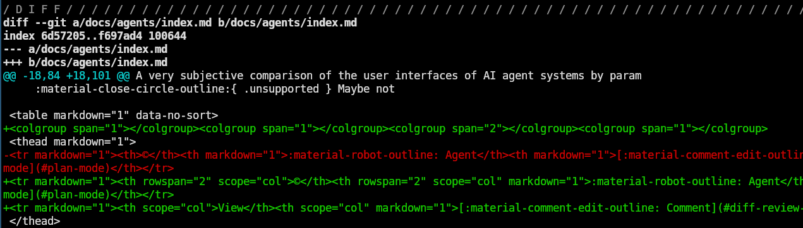
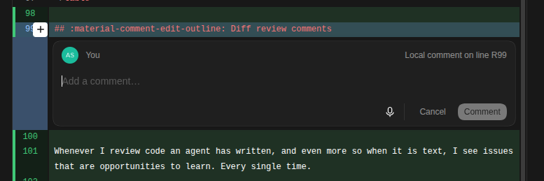
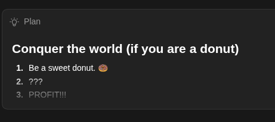

# AI agent tools

A very subjective comparison of the user interfaces of AI agent systems by parameters I find influencing whatever I am doing with them, which is mostly writing text or code.

!!! info inline end "Legend"

    :material-check-circle-outline: Supported

    :material-close-circle-outline:{ .unsupported } Maybe not

<table markdown="1" data-no-sort>
<colgroup span="1"></colgroup><colgroup span="1"></colgroup><colgroup span="2"></colgroup><colgroup span="1"></colgroup>
<thead markdown="1">
<tr markdown="1"><th rowspan="2" scope="col">©</th><th rowspan="2" scope="col" markdown="1">:material-robot-outline: Agent</th><th colspan="2" scope="colgroup">Diff</th><th rowspan="2" scope="col" markdown="1">[:material-clipboard-list-outline: Plan mode](#plan-mode)</th></tr>
<tr markdown="1"><th scope="col" markdown="1">[:material-file-compare: View](#diff-view)</th><th scope="col" markdown="1">[:material-comment-edit-outline: Comment](#diff-review-comments)</th></tr>
</thead>
<tbody markdown="1">
<tr markdown="1">
<th scope="rowgroup" rowspan="2" markdown="1">[:simple-anthropic: Anthropic](https://www.anthropic.com/)</th>
<td markdown="1">[:simple-claude: Claude Code](https://code.claude.com/docs/en/overview) (CLI)</td>
<td class="status-supported" markdown="1">[:material-check-circle-outline:](https://code.claude.com/docs/en/commands "Open the diff viewer with /diff")</td>
<td class="status-maybe-not" markdown="1">[:material-close-circle-outline:](https://code.claude.com/docs/en/interactive-mode "Selecting a diff line is not supported in Claude Code CLI"){ .unsupported }</td>
<td class="status-supported" markdown="1">[:material-check-circle-outline:](https://code.claude.com/docs/en/commands "Plan mode in Claude Code CLI")</td>
</tr>
<tr markdown="1">
<td markdown="1">[:simple-claude: Claude Desktop](https://code.claude.com/docs/en/desktop) (Code)</td>
<td class="status-supported" markdown="1">[:material-check-circle-outline:](https://code.claude.com/docs/en/desktop#review-changes-with-diff-view "Review changes in the diff view")</td>
<td class="status-supported" markdown="1">[:material-check-circle-outline:](https://code.claude.com/docs/en/desktop#review-changes-with-diff-view "Comment on diff lines in Claude Desktop")</td>
<td class="status-supported" markdown="1">[:material-check-circle-outline:](https://code.claude.com/docs/en/desktop "Plan mode in Claude Desktop")</td>
</tr>
<tr markdown="1">
<th scope="rowgroup" rowspan="2" markdown="1">[:simple-spacex: SpaceX](https://www.sec.gov/Archives/edgar/data/1181412/000162828026066903/spacex-cursorformsx8.htm) › [:simple-cursor: Anysphere](https://cursor.com/terms-of-service)</th>
<td markdown="1">[:simple-cursor: Cursor Editor](https://cursor.com/)</td>
<td class="status-supported" markdown="1">[:material-check-circle-outline:](https://docs.cursor.com/en/agent/review "Review changes in the diff view")</td>
<td class="status-supported" markdown="1">[:material-check-circle-outline:](https://forum.cursor.com/t/allow-commenting-diffs-when-reviewing-changes/163482 "Select diff lines and add them to chat")</td>
<td class="status-supported" markdown="1">[:material-check-circle-outline:](https://cursor.com/docs/agent/plan-mode "Plan mode in Cursor")</td>
</tr>
<tr markdown="1">
<td markdown="1">[:simple-cursor: Cursor CLI](https://cursor.com/docs/cli/overview)</td>
<td class="status-supported" markdown="1">[:material-check-circle-outline:](https://cursor.com/docs/cli/using#review "Review changes in the CLI")</td>
<td class="status-maybe-not" markdown="1">[:material-close-circle-outline:](https://cursor.com/docs/cli/using#review "Selecting a diff line is not supported in Cursor CLI"){ .unsupported }</td>
<td class="status-supported" markdown="1">[:material-check-circle-outline:](https://cursor.com/docs/cli/using "Plan mode in Cursor CLI")</td>
</tr>
<tr markdown="1">
<th scope="rowgroup" rowspan="3" markdown="1">[:simple-google: Google](https://about.google/)</th>
<td markdown="1">[:simple-googlegemini: Gemini CLI](https://geminicli.com/)</td>
<td class="status-supported" markdown="1">[:material-check-circle-outline:](https://github.com/google-gemini/gemini-cli/blob/main/packages/cli/src/ui/components/messages/ToolConfirmationMessage.tsx#L655-L685 "Preview a diff in the edit confirmation")</td>
<td class="status-maybe-not" markdown="1">[:material-close-circle-outline:](https://geminicli.com/docs/ide-integration/ "Diff-line references are not supported in Gemini CLI"){ .unsupported }</td>
<td class="status-supported" markdown="1">[:material-check-circle-outline:](https://geminicli.com/docs/cli/plan-mode/ "Plan mode in Gemini CLI")</td>
</tr>
<tr markdown="1">
<td markdown="1">[:simple-google: Antigravity Editor](https://antigravity.google/)</td>
<td class="status-supported" markdown="1">[:material-check-circle-outline:](https://antigravity.google/docs/review-changes-editor "Review changes in the editor")</td>
<td class="status-supported" markdown="1">[:material-check-circle-outline:](https://antigravity.google/docs/review-changes-editor "Comment on diffs in Antigravity Editor")</td>
<td class="status-supported" markdown="1">[:material-check-circle-outline:](https://antigravity.google/docs/ide/implementation-plan "Planning mode in Antigravity Editor")</td>
</tr>
<tr markdown="1">
<td markdown="1">[:simple-google: Antigravity CLI](https://antigravity.google/docs/cli/)</td>
<td class="status-supported" markdown="1">[:material-check-circle-outline:](https://antigravity.google/docs/review-changes?tab=cli "Review changes in the CLI")</td>
<td class="status-supported" markdown="1">[:material-check-circle-outline:](https://antigravity.google/docs/review-changes?tab=cli "Comment on diff lines in Antigravity CLI")</td>
<td class="status-supported" markdown="1">[:material-check-circle-outline:](https://antigravity.google/docs/cli/modes/ "Plan mode in Antigravity CLI")</td>
</tr>
<tr markdown="1">
<th scope="rowgroup" rowspan="1" markdown="1">[:simple-zedindustries: Zed Industries](https://zed.dev/)</th>
<td markdown="1">[:simple-zedindustries: Zed](https://zed.dev/)</td>
<td class="status-supported" markdown="1">[:material-check-circle-outline:](https://zed.dev/docs/all-actions "Review changes in the diff view")</td>
<td class="status-supported" markdown="1">[:material-check-circle-outline:](https://zed.dev/docs/all-actions "Store diff review comments and send them to the agent")</td>
<td class="status-supported" markdown="1">[:material-check-circle-outline:](https://github.com/zed-industries/zed/issues/45730 "Plan mode is available with Claude Code in Zed; the native Zed agent has its own roadmap")</td>
</tr>
<tr markdown="1">
<th scope="rowgroup" rowspan="2" markdown="1">[:simple-opencode: Anomaly](https://opencode.ai/)</th>
<td markdown="1">[:simple-opencode: OpenCode CLI](https://opencode.ai/docs/)</td>
<td class="status-supported" markdown="1">[:material-check-circle-outline:](https://opencode.ai/changelog/v1.15.6 "Review changes in the terminal diff viewer")</td>
<td class="status-maybe-not" markdown="1">[:material-close-circle-outline:](https://github.com/anomalyco/opencode/issues/50561 "Selecting a diff line is not supported in OpenCode CLI"){ .unsupported }</td>
<td class="status-supported" markdown="1">[:material-check-circle-outline:](https://opencode.ai/docs/agents/ "Plan agent in OpenCode CLI")</td>
</tr>
<tr markdown="1">
<td markdown="1">[:simple-opencode: OpenCode Desktop](https://dev.opencode.ai/desktop)</td>
<td class="status-supported" markdown="1">[:material-check-circle-outline:](https://dev.opencode.ai/desktop "Review changes in the desktop diff view")</td>
<td class="status-supported" markdown="1">[:material-check-circle-outline:](https://dev.opencode.ai/desktop "Comment on diff lines in OpenCode Desktop")</td>
<td class="status-supported" markdown="1">[:material-check-circle-outline:](https://github.com/anomalyco/opencode/issues/55200 "Enable Show agent in Settings → General to select Plan mode")</td>
</tr>
<tr markdown="1">
<th scope="rowgroup" rowspan="3" markdown="1">[:fontawesome-brands-openai: OpenAI](https://openai.com/)</th>
<td markdown="1">[:fontawesome-brands-openai: Codex CLI](https://developers.openai.com/codex/cli/)</td>
<td class="status-supported" markdown="1">[:material-check-circle-outline:](https://learn.chatgpt.com/docs/developer-commands#review-changes-with-diff "Open the diff with /diff")</td>
<td class="status-maybe-not" markdown="1">[:material-close-circle-outline:](https://learn.chatgpt.com/docs/developer-commands#built-in-slash-commands "Selecting a diff line is not supported in Codex CLI"){ .unsupported }</td>
<td class="status-supported" markdown="1">[:material-check-circle-outline:](https://learn.chatgpt.com/docs/developer-commands#built-in-slash-commands "Use /plan in Codex CLI")</td>
</tr>
<tr markdown="1">
<td markdown="1">[:fontawesome-brands-openai: Codex Desktop](https://developers.openai.com/codex/)</td>
<td class="status-supported" markdown="1">[:material-check-circle-outline:](https://openai.com/index/introducing-the-codex-app/ "Review changes in the diff view")</td>
<td class="status-supported" markdown="1">[:material-check-circle-outline:](https://openai.com/index/introducing-the-codex-app/ "Comment on the diff in Codex Desktop")</td>
<td class="status-supported" markdown="1">[:material-check-circle-outline:](https://developers.openai.com/blog/run-long-horizon-tasks-with-codex "Plan mode in the Codex app")</td>
</tr>
<tr markdown="1">
<td markdown="1">[:fontawesome-brands-openai: Codex Remote](https://developers.openai.com/blog/mastering-codex-remote-for-engineering)</td>
<td class="status-supported" markdown="1">[:material-check-circle-outline:](https://developers.openai.com/blog/mastering-codex-remote-for-engineering "Review changes in the diff view")</td>
<td class="status-supported" markdown="1">[:material-check-circle-outline:](https://developers.openai.com/blog/mastering-codex-remote-for-engineering "Comment on diff lines in Codex Remote")</td>
<td class="status-supported" markdown="1">[:material-check-circle-outline:](https://developers.openai.com/blog/mastering-codex-remote-for-engineering "Plan mode in Codex Remote")</td>
</tr>
</tbody>
</table>

## :material-file-compare: Diff view

A diff view shows changes in the agent tool, so that you do not have to run a separate editor or terminal.

## :material-comment-edit-outline: Diff review comments

{ align=right }

Whenever I review code an agent has written, and even more so when it is text, I see issues that are opportunities to learn. Every single time.

These issues can lead to new checks, linters, guidance, or skills. I want to comment on a specific line in the diff and give the agent feedback there. Often, I immediately ask it to `/retro` the issue: my skill turns a mistake into improved guidance.

## :material-clipboard-list-outline: Plan mode { style="clear: both;" }

{ align=right }

[Robert Martin argues](https://howmanyctospod.com/episodes/81-theres-a-pattern-to-follow-an-interview-with-robert-uncle-bob-martin) that large specifications written up front bring back the problems of waterfall. I agree, and I no longer write specs. I do write plans quite a bit.

One reason is to split the work: a smarter agent can write a plan, and a team of lighter models can implement it. This resembles the [orchestrator–workers pattern](https://agentpatterns.org/patterns/orchestrator-workers/), where an agent divides work among other agents.
